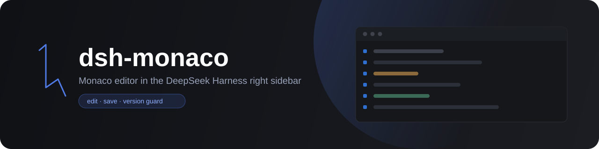

<div align="center">



# dsh-monaco

**A real Monaco editor inside the DeepSeek Harness right sidebar: open a text or code file and edit it in place, save it under a version guard, and extend it from your own plugins with language and theme registrations.**

English | [简体中文](README.zh_CN.md)

[](https://github.com/topics/dsh-plugin)


</div>


`dsh-monaco` replaces the right sidebar's read-only file preview for text and code files with an editable Monaco instance. It reads through the platform's own `remote.workspaceFiles` channel, writes through a host route it registers itself (the platform file service is read-only), and exports `ctx.monacoEditor` so other plugins can register languages, Monarch tokenizer rules, themes, commands, and actions.

## Features

| Capability | Detail |
|---|---|
| Takes over the file preview | Registers a document-preview implementation at `extension` priority, covering the built-in code preview and the plain-text fallback. Images, PDF, Office, and Excel still render through the platform's own implementations. |
| In-place edit and save | `Ctrl/Cmd+S` writes back to disk, and closing a tab offers the same. A successful save refreshes the local baseline; undo/redo, cursor, and scroll position survive switching to another tab. |
| Unsaved marker | A tab with changes draws its chip `×` as a dot (hover restores the `×`), matching VS Code. |
| Close confirmation | Closing a tab with unsaved changes asks Save / Don't Save / Cancel: Esc cancels, Enter saves. A failed save keeps the dialog open and shows the reason inside it. |
| Version guard | A save carries the file version observed at read time. If the file changed on disk since, the host answers `409` and the UI offers Reload or Overwrite anyway — never a silent overwrite. |
| Follows the UI theme | Monaco colors are derived from `--dsw-alias-*` variables (selection uses the theme's own document-selection veil, cursor and focus use the brand accent, scrollbars use border colors) and follow light/dark switches. A registered theme can be pinned in config instead. |
| Follows font settings | Code font family and size come from the code font in Settings → Appearance and apply immediately, without reopening the file. |
| Editor settings | The gear at the left of the status bar opens a global settings panel (shared by every editor in the browser, persisted in `localStorage`). It currently offers Word wrap. |
| Popup colors | The context menu and command palette follow the UI theme, including the corner radius, border, and shadow they depend on. |
| Localization | Strings register into the platform locale system; Monaco's own message bundles load per UI language (`zh-cn`, `zh-tw`, `ja`, `ko`, `de`, and others). |
| Extension API | `ctx.monacoEditor`: register languages with Monarch rules or a hand-written line tokenizer, semantic-token providers with their token colors, themes, commands, actions, extra claimed extensions, and subscribe to editor mount/unmount and document open/save/change/close. |

## How it works

1. **Editor assets.** The host mounts the whole `monaco-editor/min/vs` directory under `/dsh-monaco/vs/` as a `kind: 'prefix'` route. The browser injects `loader.js` and loads the AMD module `vs/editor/editor.main`. Language packs, fonts, and the four language workers all come from Monaco's own directory layout, so the plugin's own bundle stays small.

2. **Asset hardening.** A request path is decoded first, then validated segment by segment: `.`/`..`, an embedded `/` or `\` inside a single segment, and NUL are rejected, and only a whitelisted set of extensions passes. The resolved absolute path is checked for containment once more before the file is read.

3. **Reading.** Reads go through the platform's `remote.workspaceFiles.readBytes` (per-session authorization, with a byte ceiling) and are decoded strictly as UTF-8. Decode failures, missing files, and oversize reads surface a readable message rather than a silent fallback.

4. **Writing.** The platform file remote is read-only, so the plugin registers `POST /dsh-monaco/api/write` on the host: validate protocol version and JSON shape → resolve the session cwd → `lstat` and reject non-regular files → resolve the sandbox policy for the session → `fs.writeText` with a `replaceIfVersion` guard. `FS_STALE_VERSION` maps to `409 stale-version`; a sandbox refusal maps to `403`.

5. **Document takeover.** The implementation registered with `ctx.documentPreviews` works in `renderer` mode and reads the whole file itself. Switching away from a tab unmounts the view, but the Monaco model and unsaved text stay in plugin state; they are released only when the tab record disappears (`tab.signal` aborts).

6. **Theme and font.** On `theme/change` the colors are re-derived and `defineTheme` runs again. These variables' *declared* values are usually another `var()` (or even `color-mix()`), while Monaco only accepts resolved colors and a real font-family list — so instead of chaining variables by hand, `var(--x, sentinel)` is applied to a temporary element's standard property and the browser-resolved value is read back with `getComputedStyle`. The sentinel distinguishes "variable not defined".

    The value read back must then be normalized to **hexadecimal**: Monaco 0.57 theme colors accept only `#rrggbb` / `#rrggbbaa`, and passing `rgb()`, `rgba()`, or `color(srgb …)` throws `Illegal value for token color` inside `editor.create`, leaving the editor half-initialized (default white background, no syntax coloring). A value of `undefined` throws as well, so unparseable keys are simply omitted and left to the base theme, and a variable that cannot be normalized produces one warning.

    Semantics matter too: `--dsw-alias-brand-primary` is the text-primary tier (near-white in dark mode, near-black in light), not the brand accent. Selection therefore uses `--dsw-alias-bg-document-selection`, cursor and focus use `--dsw-alias-brand-primary-new-colorprimary-new-color`, scrollbars use `--dsw-alias-border-l2/-l4`, and popup surfaces use `--dsw-alias-bg-layer-3`. When stacking alpha, the existing alpha is multiplied (`border-l1` is already 6% white; overwriting it would blow it up to 50%).

    Fonts come from the composed `--ds-font-family-code` and `--dsh-code-font-size` on `body`; interface text such as the status bar uses the text stack `--dsw-font-family`.

7. **Close confirmation.** The platform's close chain is synchronous: `sidebarRight.close(tabId)` → close hook → remove the tab. The hook either returns normally (close proceeds) or throws (the tab is preserved — the platform documents *Failure preserves the tab*, and its own click path catches and logs the exception). So "show a confirmation dialog" is implemented as: `registerCloseHandler('text', …)` throws `TabCloseVeto` to abort the close when the tab has unsaved changes, and the dialog lives in `shell.overlay`. Once the user chooses, the guard issues a permitted close. The permit lasts only for that one synchronous call, so it never leaks into the next close.

    The chip `×` is rendered by the platform's docking component and has no replacement hook, so the dot leaves the title alone: it sets a `data-dsh-monaco-tab-dirty` marker on the close button and the stylesheet turns the icon into a dot (`visibility`, not `display`, so the button keeps its size and the strip does not jitter). The marker is re-applied both when the dirty state changes and when the strip re-renders, since React remounts nodes and drops foreign attributes.

    Two platform behaviors are known and left as they are: `Ctrl/Cmd+W` goes through the platform's shortcut dispatcher, which has no `try/catch`, so a keyboard close logs one thrown `TabCloseVeto` to the console — the dialog still appears and nothing else is affected; and when the platform "replaces a tab with new content" it runs the same close hook, so the dialog's Save closes the old tab first and that navigation has to be reissued. Both are properties of the platform close chain, not something the plugin works around.

8. **Popup variables.** The context menu and command palette are not rendered inside the editor — Monaco puts them in the Shadow DOM of a `div.shadow-root-host`, whose `:host { all: initial }` cuts off every inherited value, while `--vscode-*` variables are declared only on `.monaco-editor` / `.monaco-component`. Inside the popup, `background-color: var(--vscode-menu-background)` therefore fails outright (transparent background) and `color` falls back to the initial value (black) — black text on a dark background is effectively invisible.

    The fix mirrors those variables onto `document.documentElement`: a Shadow DOM host inherits from document, so custom properties propagate into the shadow tree. The values are read from Monaco's own injected `style.monaco-colors`, so re-mirroring after a theme switch keeps up and no second copy of the palette has to be maintained here. Once that color sheet is found, observation narrows to the sheet itself (Monaco switches themes by rewriting the text of an existing `<style>`), so unrelated `head` changes do not trigger a re-read.

    Monaco also only references, never defines, `--vscode-cornerRadius-*`, `--vscode-strokeThickness`, and `--vscode-shadow-lg` (in VS Code these come from the workbench stylesheet); without them the menu has no rounded corners and no border. The plugin supplies defaults: radius and stroke are fixed, and the shadow is composed from the theme's mask color. If Monaco ever declares them itself, its values win.

    The theme also writes the `menu.*` color family (background, foreground, border, separator, selection) explicitly; otherwise the menu falls back to Monaco's own grey and no longer matches the DSH layers.

9. **Editor settings.** Settings live in `localStorage` (key `dsh-monaco/editor-settings`) and are shared by the current page and other same-origin windows — cross-window sync uses the `storage` event, which the writing window does not receive, so it cannot feed back on itself. Changes are pushed to every open editor immediately.

    Word wrap currently has two sources: the global setting is the default, and the preview toolbar's button is a per-tab override. The platform's own state defaults to "on" and cannot distinguish "the user just turned it off" from "the initial value", so the toolbar value is recorded as an override only when it *changes* — the initial value at mount does not count, otherwise the global setting would never take effect. The override lives with the tab and does not follow you to another file. Changing the global setting clears the current tab's override; without that, a user who once pressed the toolbar button could never get back to "follow the global setting".

## Install

From a Git source (the source is fetched and built in place; pnpm blocks dependency build scripts by default, so approve it once when prompted):

```powershell
dsh plugin --profile web add "github:dsh-plugins/dsh-monaco"
```

Or, inside a DSH session, point `plugin_manager`'s `install_bundle` at this directory; or install a local directory from the command line:

```powershell
dsh plugin --profile web add C:\path\to\dsh-monaco
```

Building from source:

```powershell
git clone https://github.com/dsh-plugins/dsh-monaco.git
cd dsh-monaco
npm install --ignore-scripts
npm run build
npm test
```

`npm test` runs `tests/*.test.ts` directly with `node --test`, relying on type stripping in Node ≥ 22.18 (`engines.node` declares that floor).

> This package is not on npm yet. Once published, `dsh plugin --profile web add "@dsh-plugin/dsh-monaco"` will install it without a build step.

`cordis.patch.yml` inserts one host entry (`@` is a reserved YAML indicator, so the scoped package name must be quoted):

```yaml
- insert:
    - id: dsh-monaco
      name: '@dsh-plugin/dsh-monaco'
```

After installing from a linked directory, re-running `npm run build` does **not** switch a running instance to the new host-side artifact: the module URL is unchanged, so Node's ESM cache never re-reads it. Rebuild host code and restart the dsh instance; for client-only changes, rebuild and refresh the page.

## Configuration

```yaml
- id: dsh-monaco
  name: '@dsh-plugin/dsh-monaco'
  config:
    editor:
      fontSize: 13
      tabSize: 2
      insertSpaces: true
      minimap: false
      theme: dsh
    extensions: [log, lock]
    maxWriteBytes: 8388608
    assetCacheSeconds: 86400
```

| Field | Default | Meaning |
|---|---|---|
| `editor.fontSize` | `12` | Editor font size (8–32); **a code font size set in DSH takes precedence** |
| `editor.tabSize` | `2` | Indent width (1–8) |
| `editor.insertSpaces` | `true` | Indent with spaces |
| `editor.minimap` | `false` | Show the minimap |
| `editor.theme` | `'dsh'` | `dsh` follows the UI theme; any registered theme id may be pinned instead |
| `extensions` | `[]` | Extra extensions to claim beyond the built-in set (a leading dot is allowed) |
| `maxWriteBytes` | `8388608` | Largest text accepted in one save; anything above is refused, never truncated |
| `assetCacheSeconds` | `86400` | Browser cache lifetime for Monaco's static assets |

Config is injected through `webserver/index-inject` as `window.__DSH_MONACO_CONFIG__`, so the host and the browser read the same values.

## Extension API

Declare `'monacoEditor'` in your plugin's `export const inject` to use the client-side Cordis service `ctx.monacoEditor`.

```ts
export const inject = ['monacoEditor']

export function apply(ctx: Context): void {
  // Language + Monarch rules + language configuration
  ctx.effect(() => ctx.monacoEditor.registerLanguage({
    id: 'glsl',
    label: 'GLSL',
    extensions: ['.glsl', '.vert', '.frag'],
    tokens: {
      keywords: ['void', 'float', 'vec2', 'vec3', 'vec4', 'uniform', 'in', 'out'],
      tokenizer: {
        root: [
          [/\/\/.*$/, 'comment'],
          [/[a-zA-Z_]\w*/, { cases: { '@keywords': 'keyword', '@default': 'identifier' } }],
          [/\d+\.?\d*/, 'number'],
        ],
      },
    },
    configuration: { comments: { lineComment: '//' }, brackets: [['{', '}'], ['[', ']'], ['(', ')']] },
  }))

  // Theme: layered over one of Monaco's base themes
  ctx.effect(() => ctx.monacoEditor.registerTheme({
    id: 'dsh-monaco-solarized',
    label: 'Solarized',
    base: 'vs-dark',
    inherit: true,
    rules: [{ token: 'comment', foreground: '586e75' }],
    colors: { 'editor.background': '#002b36' },
  }))

  // Commands and actions: keybindings need Monaco's constants, so register after ready
  void ctx.monacoEditor.ready.then(() => {
    const monaco = ctx.monacoEditor.monaco
    if (monaco === undefined) return
    ctx.effect(() => ctx.monacoEditor.registerCommand({
      id: 'dsh-monaco.insertTimestamp',
      label: 'Insert timestamp',
      keybindings: [monaco.KeyMod.CtrlCmd | monaco.KeyCode.KeyK],
      run: ({ editor, monaco }) => {
        const line = editor.getPosition()?.lineNumber ?? 1
        editor.executeEdits('timestamp', [{
          range: new monaco.Range(line, 1, line, 1),
          text: `${new Date().toISOString()} `,
        }])
      },
    }))
  })

  // Extra claimed extensions
  ctx.effect(() => ctx.monacoEditor.registerFileExtensions(['log', 'properties.local']))

  // Semantic tokens plus their token colors: the follow-theme derived themes carry no rules of
  // their own, so a contribution states the colors for each UI scheme itself.
  ctx.effect(() => ctx.monacoEditor.registerSemanticTokens({
    id: 'acme/semantic-tokens',
    language: ['glsl', 'plaintext'],
    tokenRules: {
      light: [{ token: 'variable', foreground: '001080' }],
      dark: [{ token: 'variable', foreground: '74B0DF' }],
    },
    provider: {
      getLegend: () => ({ tokenTypes: ['variable', 'number'], tokenModifiers: [] }),
      provideDocumentSemanticTokens: model => ({ data: encode(model) }),
      releaseDocumentSemanticTokens: () => {},
    },
  }))

  // Editor instances: decorations, listeners, and any DOM work hang here and are released on unmount
  const cleanups = new Map<string, () => void>()
  ctx.effect(() => ctx.monacoEditor.events.onDidMountEditor(({ tabId, editor }) => {
    const collection = editor.createDecorationsCollection([])
    cleanups.set(tabId, () => { collection.clear() })
  }))
  ctx.effect(() => ctx.monacoEditor.events.onDidUnmountEditor(({ tabId }) => {
    cleanups.get(tabId)?.()
    cleanups.delete(tabId)
  }))

  // Document events
  ctx.effect(() => ctx.monacoEditor.events.onDidSaveDocument(({ sessionId, path, version }) => {
    ctx.logger.info('saved %s (%s) in %s', path, version, sessionId)
  }))
}
```

`registerLanguage` follows Monaco's `languages.register` field semantics: `extensions`, `filenames`, and `filenamePatterns` decide file matching, `tokens` is the Monarch rule set, and `configuration` is the language configuration. Plugin-registered languages rank ahead of Monaco's built-ins, so a plugin declaration wins for the same extension. The `loader` field loads another contribution bundle before the rules are applied (for example `globalThis.require(['vs/basic-languages/…'])`). `tokensProvider` is the escape hatch for languages that need cross-line state Monarch cannot express (block scalars, indentation stacks): it is a hand-written line tokenizer wired straight into `languages.setTokensProvider`. It is mutually exclusive with `tokens`; declaring both throws at registration.

`registerSemanticTokens` registers a `DocumentSemanticTokensProvider` for a language selector (`'yaml'` as well as your own language id — the built-in `yaml` language is registered by Monaco and available). The provider decides per document whether it applies. `tokenRules` must cover every type in the provider's legend for both schemes: Monaco paints a semantic token with the theme's foreground for that type, and a type with no rule falls back to the body foreground. The rules land in the global token theme, so `{ token: 'string' }` also recolors `string` Monarch tokens in every other language.

The editor runs with `'semanticHighlighting.enabled': true`: Monaco's standalone theme service hard-codes the theme-side switch to off, so a contributed provider could otherwise never paint anything. It is a global option — Monaco instances other plugins create on the same page get semantic highlighting too.

Full `monacoEditor` surface:

| Member | Meaning |
|---|---|
| `version` | Extension API version, currently `1` |
| `ready` | Promise resolved once Monaco is ready; the editor API is safe to call inside it |
| `monaco` | The loaded Monaco namespace, `undefined` before it is ready |
| `registerLanguage(contribution)` | Register a language, its rules (Monarch or a `tokensProvider`), and its configuration; returns a disposer |
| `registerTheme(contribution)` | Register a color theme layered over a built-in base theme |
| `registerSemanticTokens(contribution)` | Register a semantic-token provider for one or more languages, plus its token colors per UI scheme |
| `registerCommand(contribution)` | Register a command (command palette, optional keybindings) |
| `registerAction(contribution)` | Register an action (optional Monaco context-key precondition) |
| `registerFileExtensions(extensions)` | Claim additional file extensions for the editor |
| `getActiveEditor()` | The focused editor as `{ editor, monaco, document }`, or `undefined` when none is open |
| `openFile({ sessionId, path, line? })` | Open a file in the sidebar, optionally revealing a line |
| `events.onDidMountEditor / onDidUnmountEditor` | Editor instance lifecycle; the mount event carries `{ editor, monaco, tabId, sessionId, path, languageId }` |
| `events.onDidOpenDocument / onDidSaveDocument / onDidChangeDocument / onDidCloseDocument` | Document lifecycle |

Members added after `0.1.x` are detected by presence (`typeof service.registerSemanticTokens === 'function'`); `version` only increments for incompatible changes, so it cannot tell a `0.1.x` consumer whether a new member exists.

## Development

```powershell
npm run typecheck   # both tsconfigs: host and client
npm test            # node --test, type stripping over tests/*.test.ts
npm run build       # build:host (tsc) + build:client (tsdown + declarations)
```

The source has three layers:

- `src/shared/` — pure logic shared by host and browser (address construction, asset path validation, extension normalization, language matching, the save protocol, locale mapping). Tests concentrate on these runtime-independent rules.
- `src/` (top level) — the host half: asset route, write route, Monaco directory resolution, config.
- `src/client/` — the browser half: Monaco loader, theme derivation and popup variables, extension registry, editor state, save channel, close guard, editor settings and view, and the exported service.

`tsdown.client.config.mjs` wraps the client output as `window.__ModuleLoader__.load({ id: "@dsh-plugin/dsh-monaco", factory })` — the registration id must equal the package name, because the platform looks the factory up by entry id and otherwise reports *loaded without registering*. `react`, `react-dom`, and `@deepseek-ai/cordis` stay external; everything else is inlined. At runtime the plugin never value-imports `@deepseek-ai/*`: each half declares only the service faces it actually uses (`src/host-types.ts`, `src/client/types.ts`).

## Verification checklist

- [x] Boot log has no `plugin tree failed to load`, and the client entry appears in `window.__DSH_BOOT__.entries`
- [x] `__DSH_MONACO_CONFIG__` matches the host config
- [x] `/dsh-monaco/vs/loader.js`, `editor.main.js`, `editor.main.css`, the locale packs, and the workers all answer 200 with the right Content-Type
- [x] `/dsh-monaco/vs/../../package.json`, `..%2f..%2fpackage.json`, and `..%5c..%5cpackage.json` all answer 404
- [x] Write route: normal write 200, wrong method 405, non-JSON content type 415, malformed JSON 400, stale version 409, missing file 404, oversize 413
- [x] The client artifact declares nothing outside `__ModuleLoader__.load`, and `factory` returns `{ name, inject, apply, VIEWER_ID }`
- [x] The status bar has no Save button, and `Ctrl+S` still writes to disk
- [x] A tab with unsaved changes turns its chip `×` into a dot (`data-dsh-monaco-tab-dirty`, icon `visibility: hidden`, button size unchanged)
- [x] Closing a changed tab opens the dialog; Cancel and Esc keep the tab and its changes, Don't Save closes it without touching the file, Save closes it after a successful write
- [x] The context menu is opaque and readable: background `rgb(53, 54, 56)`, text `rgb(249, 250, 251)`, 8px radius, 1px border
- [x] The settings gear sits at the far left of the status bar; toggling Word wrap changes Monaco's `wordWrap`, persists to `localStorage`, and survives a page reload

## License

LGPL-3.0-only. Monaco Editor is published by Microsoft under the MIT license; it is installed as a dependency and is not redistributed by this repository.
