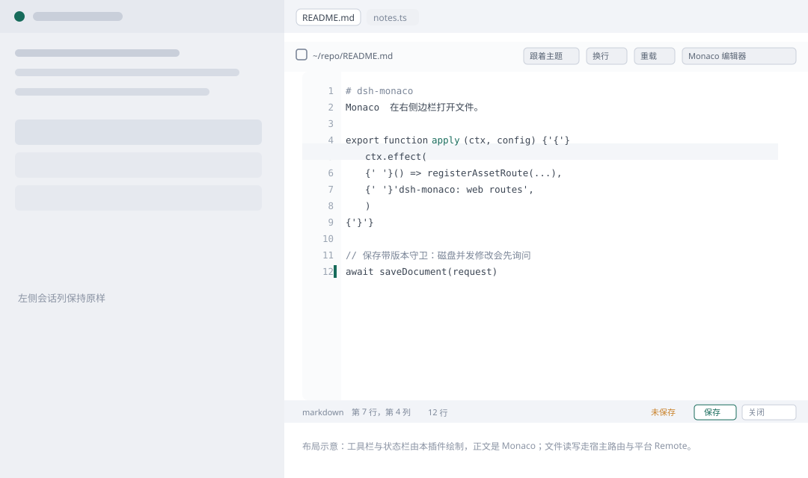

# dsh-monaco

把 Monaco 编辑器接到 DeepSeek Harness 的右侧边栏：打开工作区里的文本或代码文件时，看到的是可编辑、可直接保存的编辑器，而不是只读预览。插件同时向其他插件开放语言、高亮规则、主题、命令与动作的注册接口。



## 功能 

| 能力 | 说明 |
|---|---|
| 接管文件预览 | 以 `extension` 优先级注册文档预览实现，覆盖内置的代码预览与纯文本回退；图片、PDF、Office、Excel 仍由平台原实现呈现 |
| 就地编辑与保存 | `Ctrl/Cmd+S` 写回磁盘，关闭标签页时也会提示保存；保存成功即刷新本地基线，撤销/重做、光标与滚动位置在切换到别的标签页后仍然保留 |
| 未保存标记 | 有改动的标签页把芯片上的 `×` 画成圆点（悬停恢复成 `×`），与 VS Code 一致 |
| 关闭确认 | 有未保存改动时关闭标签页会弹出「保存 / 不保存 / 取消」确认框：Esc 取消、Enter 保存；保存失败时确认框不会消失，并把原因留在框内 |
| 版本守卫 | 保存携带读取时观察到的文件版本；磁盘已被别的进程改动时返回 `409`，界面给出「重新加载」与「仍然覆盖」两条明确出路，不做静默覆盖 |
| 跟随界面主题 | 从 `--dsw-alias-*` 变量派生 Monaco 配色（选中用主题自己的文档选中蒙层，光标与焦点用品牌强调色，滚动条用边框色），界面切换亮色/暗色时同步切换；也可以在配置里固定成某个已注册主题 |
| 跟随字体设置 | 代码字体与字号取自「设置 → 外观」里的代码字体，改完立即生效，无需重开文件 |
| 多语言 | 词条注册进平台文案系统；Monaco 自带消息包按界面语言加载（`zh-cn`、`zh-tw`、`ja`、`ko`、`de` 等） |
| 扩展接口 | `ctx.monacoEditor`：注册语言与 Monarch 高亮规则、主题、命令、动作，追加接管的扩展名，订阅文档打开/保存/修改/关闭事件 |

## 机制

1. **编辑器资源**：宿主把 `monaco-editor/min/vs` 整棵目录挂在 `/dsh-monaco/vs/` 下（`kind: 'prefix'` 路由），浏览器注入 `loader.js` 后按 AMD 模块 `vs/editor/editor.main` 加载。语言包、字体与四个语言 Worker 都由 Monaco 自己的目录结构提供，插件产物本身只有约 75 KB。
2. **资源防护**：请求路径先解码再逐段校验，拒绝 `.`/`..`、藏在单段里的 `/` 与 `\`、NUL，只放行白名单扩展名；解析出的绝对路径再做一次目录包含检查，随后才读盘。
3. **读取**：走平台已有的 `remote.workspaceFiles.readBytes`（按会话授权、带字节上限），以 UTF-8 严格解码；解码失败、文件不存在、超限等情况给出可读提示，不做静默降级。
4. **写入**：平台的文件远程服务是只读的，因此本插件在宿主注册 `POST /dsh-monaco/api/write`：校验协议版本与 JSON 形状 → 解析会话 cwd → `lstat` 拒绝非普通文件 → 按会话解析沙箱策略 → `fs.writeText` 带 `replaceIfVersion` 守卫。`FS_STALE_VERSION` 映射为 `409 stale-version`，沙箱拒绝映射为 `403`。
5. **文档接管**：注册进 `ctx.documentPreviews` 的实现以 `renderer` 模式工作，自己读取整份文件；标签页切走时视图卸载，但 Monaco 模型与未保存文本留在插件状态里，标签页记录消失（`tab.signal` 中止）时才释放。
6. **主题与字体**：`theme/change` 触发时重新派生配色并 `defineTheme`。这些变量的**声明值**往往还是一串 `var()`（甚至 `color-mix()`），而 Monaco 只接受最终颜色与真实字体族串，所以不手工沿变量链拼接，而是把 `var(--x, 哨兵)` 套到一个临时元素的标准属性上，再从 `getComputedStyle` 读回浏览器解析后的结果；哨兵值用来区分「变量不存在」。

   读回的值还必须再规范成**十六进制**：Monaco 0.57 的主题色只认 `#rrggbb` / `#rrggbbaa`，传入 `rgb()` / `rgba()` / `color(srgb …)` 会在 `editor.create` 时抛 `Illegal value for token color`，整个编辑器停在半初始化状态（默认白底、无语法着色）。值为 `undefined` 同样会抛错，所以解析不出的键直接不写、交给基础主题补齐，无法规范的变量写一条 warn 日志。

   语义也要对上：`--dsw-alias-brand-primary` 是文字主色级（暗色近白、亮色近黑），不是品牌强调色。因此选中用 `--dsw-alias-bg-document-selection`，光标与焦点框用 `--dsw-alias-brand-primary-new-colorprimary-new-color`，滚动条用 `--dsw-alias-border-l2/-l4`，浮层表面用 `--dsw-alias-bg-layer-3`。叠加透明度时对既有 alpha 做乘法（`border-l1` 本身就是 6% 的白，覆盖会把它放大成 50%）。

   字体取 body 上合成好的 `--ds-font-family-code` 与 `--dsh-code-font-size`；状态栏等界面文字用正文栈 `--dsw-font-family`。
7. **关闭确认**：平台的关闭链路是同步的——`sidebarRight.close(tabId)` → 关闭钩子 → 移除标签页；钩子要么正常返回（继续关），要么抛错（保留标签页，平台文档写明 *Failure preserves the tab*，点击路径上平台自己捕获并记录该异常）。所以「弹出确认框」实现为：`registerCloseHandler('text', …)` 在标签页有未保存改动时抛 `TabCloseVeto` 中止这次关闭，确认框挂在 `shell.overlay` 里；用户选完再由守卫发起一次被放行的关闭。放行只在这一次同步调用内有效，不会残留到下一次关闭。

   标签页上的 `×` 由平台停靠组件渲染，没有可替换的接口，所以圆点不改标题、只在关闭按钮上打 `data-dsh-monaco-tab-dirty` 标记，由样式把图标改成圆点（`visibility` 而非 `display`，按钮尺寸不变、标签条不抖动）。标记在脏状态变化与标签条重渲染时都会重新打一遍，避免 React 重挂节点丢掉外来属性。

   两条已知的平台侧行为：其一，`Ctrl/Cmd+W` 走平台的快捷键分发，那里没有 `try/catch`，所以按键关闭时会有一条被抛出的 `TabCloseVeto` 落到控制台——确认框照常弹出，功能不受影响；其二，平台在「用新资源替换标签页」时同样会过一遍关闭钩子，此时确认框的「保存」会先关掉旧标签页，那次导航需要重新发起。这两个都是平台关闭链路本身的性质，插件侧不做绕道。

## 安装

```powershell
git clone <repo> dsh-monaco
cd dsh-monaco
npm install --ignore-scripts
npm run build
npm test
```

`npm test` 用 `node --test` 直接运行 `tests/*.test.ts`，依赖 Node ≥ 22.18 的类型剥离能力（`engines.node` 已声明该下限）。

在 DSH 会话里用 `plugin_manager` 的 `install_bundle` 指向本目录；或在命令行：

```powershell
dsh plugin --profile web add C:\path\to\dsh-monaco
```

`cordis.patch.yml` 插入一行宿主入口：

```yaml
- insert:
    - id: dsh-monaco
      name: 'dsh-monaco'
```

以目录链接方式安装后，重新执行 `npm run build` **不会**让正在运行的实例换用新的宿主端产物：模块 URL 不变，Node 的 ESM 缓存不会重新读盘。改完宿主端代码并构建后需要重启 dsh 实例；只改客户端代码时重新构建并刷新页面即可。

## 配置

```yaml
- id: dsh-monaco
  name: 'dsh-monaco'
  config:
    editor:
      fontSize: 13
      tabSize: 2
      insertSpaces: true
      minimap: false
      theme: dsh
    extensions: [log, lock]
    maxWriteBytes: 8388608
    assetCacheSeconds: 86400
```

| 字段 | 默认 | 说明 |
|---|---|---|
| `editor.fontSize` | `12` | 编辑器字号（8–32）；**DSH 设置了代码字号时以 DSH 为准** |
| `editor.tabSize` | `2` | 缩进宽度（1–8） |
| `editor.insertSpaces` | `true` | 使用空格缩进 |
| `editor.minimap` | `false` | 显示缩略图 |
| `editor.theme` | `'dsh'` | `dsh` 跟随界面主题；也可以写某个已注册主题的 id |
| `extensions` | `[]` | 在内置接管范围之外追加扩展名（可带前导点） |
| `maxWriteBytes` | `8388608` | 单次保存允许的最大文本字节数，超过即拒绝，不截断 |
| `assetCacheSeconds` | `86400` | Monaco 静态资源的浏览器缓存秒数 |

配置通过 `webserver/index-inject` 注入为 `window.__DSH_MONACO_CONFIG__`，浏览器端与宿主端读到的值一致。

## 给其他插件用的接口

客户端 Cordis 服务 `ctx.monacoEditor`，在依赖方的 `export const inject` 里声明 `'monacoEditor'` 即可使用。

```ts
export const inject = ['monacoEditor']

export function apply(ctx: Context): void {
  // 语言 + Monarch 高亮规则 + 语言配置
  ctx.effect(() => ctx.monacoEditor.registerLanguage({
    id: 'glsl',
    label: 'GLSL',
    extensions: ['.glsl', '.vert', '.frag'],
    tokens: {
      keywords: ['void', 'float', 'vec2', 'vec3', 'vec4', 'uniform', 'in', 'out'],
      tokenizer: {
        root: [
          [/\/\/.*$/, 'comment'],
          [/[a-zA-Z_]\w*/, { cases: { '@keywords': 'keyword', '@default': 'identifier' } }],
          [/\d+\.?\d*/, 'number'],
        ],
      },
    },
    configuration: { comments: { lineComment: '//' }, brackets: [['{', '}'], ['[', ']'], ['(', ')']] },
  }))

  // 主题：基于 Monaco 内置基础主题叠加
  ctx.effect(() => ctx.monacoEditor.registerTheme({
    id: 'dsh-monaco-solarized',
    label: 'Solarized',
    base: 'vs-dark',
    inherit: true,
    rules: [{ token: 'comment', foreground: '586e75' }],
    colors: { 'editor.background': '#002b36' },
  }))

  // 命令与动作：快捷键要用 Monaco 的常量，所以在 ready 之后注册
  void ctx.monacoEditor.ready.then(() => {
    const monaco = ctx.monacoEditor.monaco
    if (monaco === undefined) return
    ctx.effect(() => ctx.monacoEditor.registerCommand({
      id: 'dsh-monaco.insertTimestamp',
      label: '插入时间戳',
      keybindings: [monaco.KeyMod.CtrlCmd | monaco.KeyCode.KeyK],
      run: ({ editor, monaco }) => {
        const line = editor.getPosition()?.lineNumber ?? 1
        editor.executeEdits('timestamp', [{
          range: new monaco.Range(line, 1, line, 1),
          text: `${new Date().toISOString()} `,
        }])
      },
    }))
  })

  // 追加接管的扩展名
  ctx.effect(() => ctx.monacoEditor.registerFileExtensions(['log', 'properties.local']))

  // 文档事件
  ctx.effect(() => ctx.monacoEditor.events.onDidSaveDocument(({ sessionId, path, version }) => {
    ctx.logger.info('saved %s (%s) in %s', path, version, sessionId)
  }))
}
```

`registerLanguage` 的字段语义与 Monaco 的 `languages.register` 一致：`extensions`、`filenames`、`filenamePatterns` 决定文件匹配，`tokens` 是 Monarch 规则，`configuration` 是语言配置；插件注册的语言排在 Monaco 自带语言之前，同一扩展名以插件声明为准。`loader` 字段可以在应用规则之前加载另一个贡献包（例如 `globalThis.require(['vs/basic-languages/…'])`）。

`monacoEditor` 的完整成员：

| 成员 | 说明 |
|---|---|
| `version` | 扩展接口版本，当前为 `1` |
| `ready` | Monaco 就绪的 Promise；在其中可以安全调用编辑器 API |
| `monaco` | 已加载的 Monaco 命名空间，尚未就绪时为 `undefined` |
| `registerLanguage(contribution)` | 注册语言、高亮规则与语言配置，返回撤销函数 |
| `registerTheme(contribution)` | 注册基于内置基础主题的配色主题 |
| `registerCommand(contribution)` | 注册命令（进命令面板，可绑定快捷键） |
| `registerAction(contribution)` | 注册动作（可带 Monaco 上下文键前置条件） |
| `registerFileExtensions(extensions)` | 追加由编辑器接管的文件扩展名 |
| `getActiveEditor()` | 当前聚焦的编辑器：`{ editor, monaco, document }`，没有打开编辑器时为 `undefined` |
| `openFile({ sessionId, path, line? })` | 在侧边栏打开文件并可选跳到某一行 |
| `events.onDidOpenDocument / onDidSaveDocument / onDidChangeDocument / onDidCloseDocument` | 文档生命周期 |

## 开发

```powershell
npm run typecheck   # 宿主端与客户端两套 tsconfig
npm test            # node --test，直接用 Node 22+ 的类型剥离跑 tests/*.test.ts
npm run build       # build:host (tsc) + build:client (tsdown + 声明文件)
```

源码分三层：

- `src/shared/`：宿主与浏览器共用的纯逻辑（地址构造、资源路径校验、扩展名归一化、语言匹配、保存协议、语言映射），测试集中在这些不依赖运行时的规则上；
- `src/`（顶层）：宿主端——资源路由、保存路由、Monaco 目录定位、配置；
- `src/client/`：浏览器端——Monaco 加载器、主题派生、扩展注册表、编辑器状态、保存通道、关闭守卫与视图、对外服务。

客户端产物由 `tsdown.client.config.mjs` 包成 `window.__ModuleLoader__.load({ id: "dsh-monaco", factory })`；`react`、`react-dom`、`@deepseek-ai/cordis` 保持外部化，其余依赖内联。运行期不对 `@deepseek-ai/*` 做值导入：宿主端只按用到的成员声明自己的服务外观（`src/host-types.ts`），客户端同理（`src/client/types.ts`）。

## 验证清单

- [x] 启动日志无 `plugin tree failed to load`，客户端条目出现在 `window.__DSH_BOOT__.entries`
- [x] `__DSH_MONACO_CONFIG__` 注入值与宿主配置一致
- [x] `/dsh-monaco/vs/loader.js`、`editor.main.js`、`editor.main.css`、多语言与 Worker 静态资源均返回 200 与正确 Content-Type
- [x] `/dsh-monaco/vs/../../package.json`、`..%2f..%2fpackage.json`、`..%5c..%5cpackage.json` 均返回 404
- [x] 保存路由：正常写入 200、方法不符 405、非 JSON 类型 415、坏 JSON 400、版本过期 409、文件不存在 404、超出上限 413
- [x] 客户端产物在 `__ModuleLoader__.load` 之外没有顶层声明，`factory` 返回 `{ name, inject, apply, VIEWER_ID }`
- [x] 状态栏没有「保存」按钮；`Ctrl+S` 仍写回磁盘
- [x] 有未保存改动时标签芯片的 `×` 变成圆点（标记属性 `data-dsh-monaco-tab-dirty`、图标 `visibility: hidden`、按钮尺寸不变）
- [x] 关闭有改动的标签页弹出确认框；「取消」与 Esc 保留标签页与改动，「不保存」关闭且磁盘不变，「保存」关闭且磁盘写入成功

## 许可

LGPL-3.0-only。Monaco Editor 由 Microsoft 以 MIT 许可发布，随依赖安装，不随本仓库分发。
